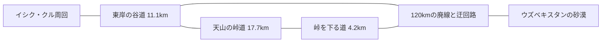

# 湖から峠へ、峠から廃線へ（2026-10-22）

別々の出発地点を選ぶだけでなく、同じ世界を走り続けて三つの風景へ移れるようにしました。元の120kmの廃線、二つの橋の迂回路、湖の一周、山道とそのトンネルは残し、二つの谷道を接続しています。実在地域をモチーフとする構成で、地理的な縮尺の再現ではありません。

## 道路と分岐

`world/featured-routes.js` の `addConnection()` は24m以下の間隔で滑らかな道路を作り、既存と同じ空間索引へ登録します。本体の `prepareJourneyNetwork()` が湖岸の高さ調整後に接続点を決めるため、山道の入口・出口で同じ頂点を共有します。廃線との接続は、描画する路面の高さまで合わせます。

- `lake-pass`: 湖の東岸から峠の入口へ11,090m。途中、x=26.8kmで既存の廃線とも接続。最大勾配約4.27%。
- `pass-line`: 峠の出口からx=52kmの廃線へ4,185m。最大勾配約4.44%。以東は草原、橋の迂回路、砂漠へ続きます。
- 五つの分岐に古びた案内標。柱は道路・廃線・別の接続路の走行範囲を避けて配置します。谷道にもキャラバンサライ、石像、放牧地の跡、壊れた水路の遠景を加えています。
- ニュートラルでは選んだ道を短い交差部で保ちます。強い操作は分岐・道路外への移動を優先します。地形描画は操作中の選択を参照しません。
- 接続路も既存の道路と同じ床判定、描画、ストリーミング、障害物の予約領域を使用します。メニューからの移動を接続の代わりにはしていません。

## カメラ

通常は後方の広い景色を中心に、従来の長い間隔の静かな寄り方を維持。カーブでは約35〜110m先の道の向きを少し先に見ます。入力の旋回方向とカメラの先読みの符号も合わせています。

敵が約1.1km以内へ近づくと、左右への景色の寄り方をやめて中央へ戻り、最大1.4m引き、0.15m上がります。湖の方へ向ける小さな構図補正も襲撃と強い左右操作の間は弱めます。FOVを大きく広げる演出や白い速度線は追加しません。

カメラの支点と目の間を、読み込み済みの実際の衝突箱と照合します。壁や梁に遮られたら手前へ寄り、視界が開くとゆっくり戻ります。峠のトンネルでは側壁・天井の内側に収めます。オービットや視点の切り替えはありません。マフラーは隣り合う帯の向きを揃え、揺れを経過時間に比例させ、メニューで静止させます。

## 検証と引継ぎ

`python tests/journey-network-browser.py --three /path/to/three.min.js` は、接続点・高さ・勾配に加え、実際の物理で湖岸の分岐後から峠を越え廃線へ約33.0km、逆向きに湖へ約32.6kmを無操作で走ります。両方向で体力3を保持し、途中のワープ・再配置はありません。入口の準備時だけテスト用に位置を設定します。プレイヤーは実際の分岐で進む道を選べます。接続路のポプラ並木が道路を横切って見える箇所も修正し、走行空間の0.75〜3.9mの高さを、二つの接続路で計1,176本の下向きのレイによって描画メッシュまで調べます。

`tests/travel-camera.test.mjs` は先読みの上限、襲撃時の中央復帰と距離、回転した壁・梁の遮蔽を検査。`python tests/journey-camera-browser.py --three /path/to/three.min.js` は実際のカメラで敵の接近、壁の手前への移動、元の距離への復帰、トンネル内の構図を検査します。`tests/horse-presentation-browser.py` は実描画の後方視点・トンネル・敵・操作・世界変更による復帰を検査します。従来の全周回、地形、弾幕、音楽の検証も合わせて行います。馬の操作と調査資料は [HORSE-RIDING.md](HORSE-RIDING.md) を参照してください。

実際のスマートフォンの操作感・熱・FPS、案内標の読み取りやすさは実機で引き続き確認してください。交差部で道路の高さも調整し、接続路の床と描画面の差は最大約0.065mに収めています。既存の道路が重なる場所では、上に描かれた実際の路面に接地します。
