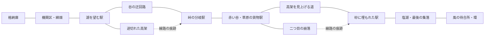

# Wind Lover — 廃線をたどるマップ

2026-10-19。添付の「廃線と高架に沿って旅することへの憧れ」を、既存の Wind Lover の地形と経路へ反映した改修。

目指すのは、遠くまで続く鉄道を見て、そこへ近づき、外れ、別の場所でまた出会える旅。従来のバイクの操作、中央アジアの景色、襲撃のオン／オフは引き継ぐ。

## 土地のつながり

奥行きは96kmから120kmへ。土地の幅は盆地で広がり、峠で狭まる。最大幅は約26.9km。64kmを過ぎると景色の順番が繰り返す構造をやめ、奥まで地域の順序を定義した。

図は経路の関係を示す。街道や脇道も残っており、廃線に従う必要はない。全ての迂回路と駅前の道は元の線へ戻れる。

## 足を止めたくなる場所

| 奥行き | 駅跡 | 風景の役割 |
| --- | --- | --- |
| 1.2km | 機関区の跡 | 拠点の外にも線路が続いていたことに気づく |
| 7.8km | 綿畑の停車場 | 生活と畑をつないでいた道 |
| 18.8km | 湖を望む駅 | 視界が開き、向こう岸の遠さを知る |
| 32.2km | 峠の分岐駅 | 崩落を回り込み、線路と再会する |
| 47.5km | 赤い谷の駅 | 山道から集落へ外れる |
| 61.0km | 草原の貨物駅 | 広い土地を運んでいた気配 |
| 77.2km | 砂に埋もれた駅 | 二つ目の迂回路の先で土地が変わる |
| 93.6km | 塩湖の停車場 | 明るい窓と、遠くへ続く線路 |
| 109.0km | 最後の集落 | 遠くまで来た先にも暮らしがある |
| 118.0km | 風の待合所 | 最後の開けた土地と環を見渡す |

駅には駅名標、ホーム、屋根、待合所、給水塔、数軒の家と窓の灯りを配置。旧い乗車券を拾える。駅前の道は約3.2kmのループになり、両端で線路へ戻る。駅の屋根の下は既存のトンネルと同様に空からの攻撃を避けられる。

28.64〜29.12kmと68.40〜68.96kmの高架は実際に途切れている。手前2.4kmから横へ外れる道を用意し、向こう側2.4kmで再接続する。飛び越える必要はない。

## 実装と確認

- 生成・当たり判定・道路の補助操舵は同じ座標関数を参照する。線路はボード用のグラインドとは別の、通常走行できる28m幅の路盤。
- 線路と道路の立体交差では、下を通る車両を上の路盤へ吸い上げない。橋脚、ホーム、建物には当たり判定がある。
- 駅と線路の近くは自動配置の大きな建物・木を避ける。遠方の線路も粗い形状で描画する。
- 読み込みは従来の480mチャンク単位。120km分の地形を一括では作らない。
- `tests/world-smoke.py` で全線の水没・地形への埋没、迂回路の連続性、橋の上下、駅の屋根、開始位置、各世界への切替、実走と画面エラーを確認する。

今回の実装は地形・道・駅の改修。会話する住民、駅ごとのイベント、拠点での強化・帰還ループは今後の内容として残る。
