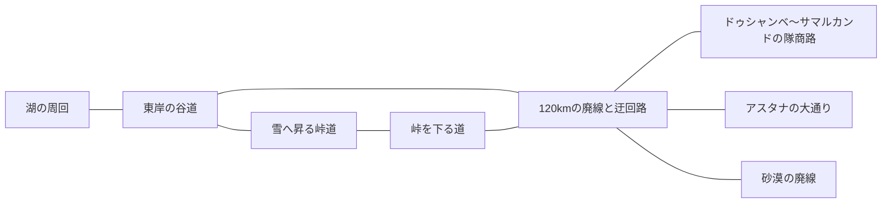

# 風と雪煙、四つの出発地点（2026-10-22）

直近の馬の操作と静かな音楽を土台に、加速、接地の表現、遠景、土地と光の変化を加えました。弾幕を読める中央の視界と、道の上で左右の走行ラインを選べる操作を維持しています。本書の速度とエフェクトの仕様が、以前の「速度は変更しない」「速度線なし」という記述に優先します。

## 疾走する馬

- 基本加速度は17から24、巡航速度は40から48m/s、基本最高速度は98から116m/s。走り続ける際の追加の引きも3.7から6.4へ変更。フローと前傾による上積みがあり、基本最高速度が実走の上限ではありません。車両の速度設定は変更していません。
- 保存済みの馬の設定は、旧既定値と同じ速度の項目だけ一度更新します。別の速度へ調整した値、他の乗り物、音楽の設定は保持します。
- 足元の土埃・雪煙は、実際の四肢の接地から発生。240個の固定プールと一つの描画で処理し、雪は小さな白い粒、土は低く広がる柔らかい粒に分けます。風の向きと速度を少し受け、空中・停止・メニューから新しい接地粒子は出ません。
- 風を切る筋は画面への重ね描きではなく、周囲に置いた52本の短い線です。進行方向の中央11mを空け、襲撃時には薄くし、動きを減らすOS設定では消します。通常の遠景と弾幕を覆うブラーはありません。
- 馬のFOVへの速度寄与の係数は2から3.2へ（既定の画角設定では約3.5度）。後方視点、カーブの先読み、壁を避けるカメラ、襲撃時の中央復帰を引き継ぎます。遠景の霧の奥行きも広げ、近景の速い流れと遠景の遅い流れの差を見せます。
- 切り返しの踏み替え、跳躍、0.32mの弾の中心判定、九つの幾何学弾幕はそのまま。馬の足元の雪と蹄音の雪面判定には、景色と同じ標高の値を使います。BGMの音源と連続再生処理は変更していません。

## 出発と地続きの道

四つの輪郭アイコンを一列に配置。選ぶ前は中立色で、出発した地点だけ枠色とチェックが付きます。アイコンは砂漠の廃線、峠道、湖、青い都を表し、全文のアクセシブルな名前とタイトルも持ちます。390pxの縦画面で同じ列に収まり、各ボタンの高さは108px以上です。

| 出発地点／エリア | 旅の変化 | 道幅 |
|---|---|---|
| ウズベキスタンの砂漠の廃線 | 既存の遺構と大きな盆地を保つ | 既存28mの保守用路盤 |
| ビシュケク〜オシュ風の峠道 | 緑の低地から標高330〜560mの間で徐々に雪へ。遠い山頂にも雪が残る | 44m |
| イシク・クル周回 | 澄んだ青空から、西へ向かい始めて夕暮れ、星空へ | 42m |
| ドゥシャンベ〜サマルカンド風の隊商路 | 約24.9km。淡い柱廊、谷と丘、隊商宿、青いドームと門へ | 44m |
| アスタナ風の未来都市 | 約9.7km。草原から高層の街、金色の冠を持つ塔、大きな天幕、開けた門へ | 64m |



新しい二つの道も既存の廃線へ両端を接続。アスタナは四つの出発アイコンとは別に、草原の廃線の案内標から入る寄り道です。都市の塔は高さ約100〜500mの複数列で構成し、二つのメッシュに統合。道路、廃線、高架の空間を空け、実際の建物には衝突判定を付けています。実在の縮尺・地理・建物の精密な再現ではありません。

湖の日没は単なる時間制ではありません。出発から1.5km以上進み、西向き成分が速度の35%を越えた後、約7.8kmの走行で夜へ移ります。短い左右回避で明るさが逆戻りせず、一周の継ぎ目も連続。停止やメニューでは進みません。新しい出発を選ぶと青空から始まります。星は空のシェーダー内で描き、遠い尾根も夜色へ落とします。

## 参考と判断

- [The Pathless の開発者紹介](https://blog.playstation.com/?p=334224)：流れる移動そのものを中心にする設計を参考に、直近の手綱操作を保ったまま加速の待ちを短縮しました。
- [Ghost of Tsushima のVFX開発解説](https://blog.playstation.com/2021/01/12/how-stunning-visual-effects-bring-ghost-of-tsushima-to-life/)：世界の風と粒子の方向をそろえる考え方を参考に、足元の粒子も既存の風を受けます。
- [UNESCO：Samarkand – Crossroad of Cultures](https://whc.unesco.org/en/list/603/)：門、青いドーム、広場を連想する輪郭を隊商路の到着側へ配置しました。
- [Visit Astana：Bayterek](https://visitastana.kz/en/about-city/what-to-see/monument-astana-bayterek/)／[Khan Shatyr](https://visitastana.kz/en/about-city/what-to-see/khan-shatyr-sec/)：金色の冠を持つ塔と巨大な天幕を、未来都市の遠景の手掛かりにしました。

上記からの独自の設計判断です。参考作品のモデル、音楽、テクスチャは流用していません。

## 検証と再監査

```sh
node --test tests/*.test.mjs
python tests/voyage-browser.py --three /path/to/three.min.js
python tests/world-smoke.py --three /path/to/three.min.js
python tests/journey-network-browser.py --three /path/to/three.min.js
python tests/featured-browser.py --full-only --vehicle horse --three /path/to/three.min.js
python tests/horse-riding-browser.py --three /path/to/three.min.js
python tests/horse-wake-browser.py --browser /usr/bin/chromium --three /path/to/three.min.js --out /tmp/horse-wake
python tests/travel-upgrade-browser.py --three /path/to/three.min.js
python tests/dodge-browser.py --vehicle horse --three /path/to/three.min.js
python tests/dodge-browser.py --three /path/to/three.min.js
python tests/music-browser.py --three /path/to/three.min.js
```

新規のブラウザ検証は、四つの未選択アイコンと現在地表示、加速の実測、新しい二つの道の走破、湖一周中の西向きへの移行と星空、風の中央空間と動きの抑制を調べます。新規道路の六つの区間では、計1,050本のレイを実際の景物メッシュへ飛ばし、走行空間の高さ0.75〜3.9mにポリゴンが入り込まないかを検査。春、雪、昼、夕暮れ、夜、青い都、未来都市は実描画の画像でも比較します。

ソフトウェアWebGLによる検証であり、実際のiPhone/SafariでのFPS、熱、タッチ操作、長時間の音は引き続き実機確認の対象です。

この改修の実測では、30m/sから80m/sへ約2.3秒、100m/sへ約3.5秒。新しい道は隊商路約24.2km・都市約9.1km、既存の峠は約17.1km・湖は約36.0kmを無衝突で走破しました。湖から峠を越える接続は往路約33.0km・復路約32.6kmとも体力3を保持。高速の切り返しは高さ約0.51〜0.54m、滞空約0.33〜0.34秒で収まりました。実際の馬の回避試験は、直進なら体力2となる同じ弾を、約5.1mの左右移動の差で体力3のまま回避しています。

音楽は実ゲームの出力約73秒を録音し、1.6秒のメインスレッド停止、曲の切替、ループの継ぎ目を含めて検査。100ms区間の最小RMSは約0.0137、隣接サンプルの最大差は約0.0204で、無音・急なクリックの検出基準を通過しました。蹄音も20/30/60/120fpsと加速中の音声クロック予約・取り消しを確認しています。
